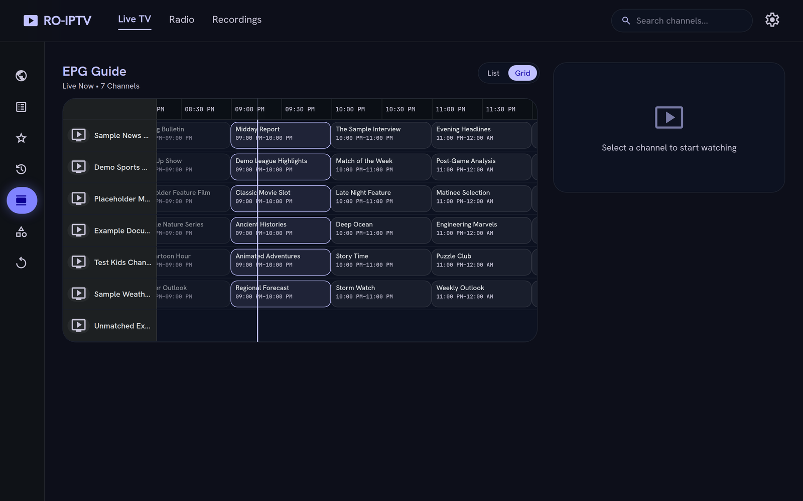
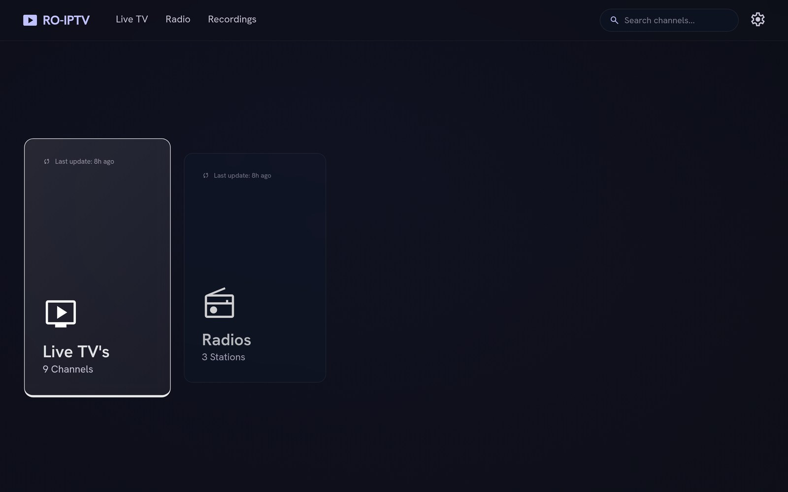
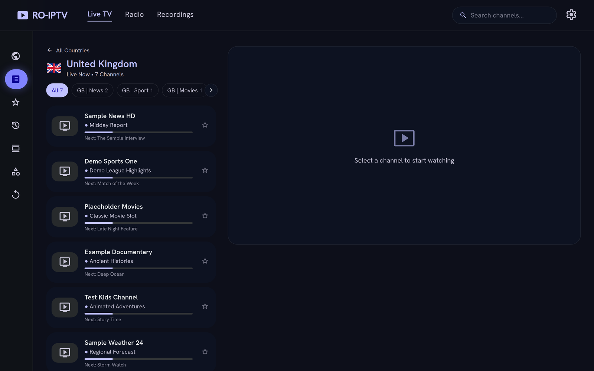
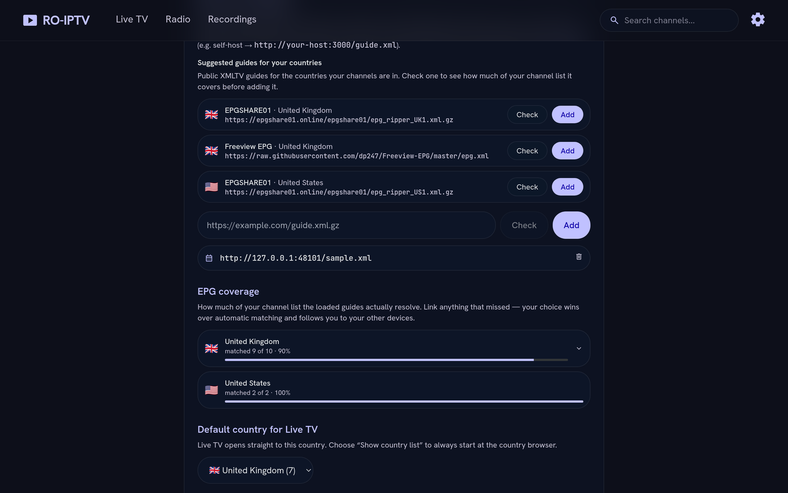
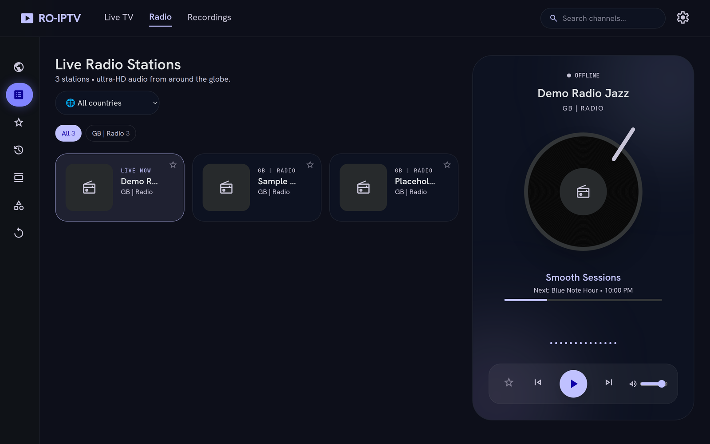

# RO-IPTV

A self-hosted **M3U / IPTV player** as an installable **Progressive Web App** — Live TV, Radio, EPG and Recordings, packaged as a **single Docker image**.

Built with React + TailwindCSS + HLS.js on the front end and a Node/Express backend that handles M3U parsing, XMLTV EPG, a CORS-bypassing stream proxy, and JSON persistence.

 



<table>
  <tr>
    <td width="50%"><br><em>Home — pick up where you left off</em></td>
    <td width="50%"><br><em>Live TV — Now/Next on every channel</em></td>
  </tr>
  <tr>
    <td><br><em>Guides suggested per country, with coverage you can see</em></td>
    <td><br><em>Radio — with live track info</em></td>
  </tr>
</table>

<sub>Screenshots use a sample playlist and a synthetic guide — the channel and programme names shown are invented.</sub>

---

## ✨ Features

- **Authentication** — optional username/password login (enable by setting `AUTH_PASSWORD`). A bootstrap `admin`/`admin` credential **forces a password change on first login**; the new password is stored salted + scrypt-hashed in the `/data` volume, retiring the default. HttpOnly signed-cookie sessions, "Remember Password", brute-force rate limiting, and a **Settings → Account** password change. If stored credentials are ever unreadable the server **fails closed** rather than reverting to an open or bootstrap state. See [Authentication](#-authentication).
- **Playlist management** — load M3U/M3U8 from URL or file upload; parses `group-title`, `tvg-logo`, `tvg-id`, `tvg-name`. Multi-playlist support with enable toggles, per-playlist Live/Radio routing, last-updated timestamps, configurable auto-refresh, and original-file download. Stored in `localStorage` **and** server-side JSON.
- **Channel browsing** — **browse by country** for large (5000+) lists, category chips with counts, real-time search, logo fallbacks, **Now/Next** EPG labels, favourites (red ★) and watch history. Set a default country for Live TV.
- **Player** — HLS.js for detected HLS, native `<video>`/`<audio>` for direct audio/video streams. A **draggable, resizable floating mini-player** (in-app PiP) keeps playback alive as you navigate, plus native Picture-in-Picture and **OS / lock-screen media controls** (Media Session with play/pause and previous/next). Remembers your last-watched channel; on mobile the player stays pinned while you scroll. **Previous channel** swaps between the last two channels you played, with a configurable keyboard shortcut.
- **EPG** — the server owns the guide: it fetches every configured XMLTV source (plain or gzipped) on a schedule, parses once, and keeps it on disk, so Now/Next is warm at first paint and survives a restart. Read it as **cards or as a time grid** (channels down, half-hourly axis across, live "now" line, click to record, pan back into catchup). Guides are matched to channels by `tvg-id`, then by name, then by iptv-org alternative names, with a manual **Link EPG** override that wins over all of them. Switch the guide to **Programmes** to search titles and subtitles across your channels and jump straight to an airing.
- **Guides without the guesswork** — Settings suggests known public XMLTV sources **for the countries your channels are actually in**, and checks a candidate before you add it: *"matches 143 of your 168 channels"*. An **EPG coverage** card then shows what resolved per country, lists what didn't, and lets you link those by hand.
- **Precision EPG (optional)** — a [sidecar](#precision-epg-optional-sidecar) that grabs a guide for *exactly your channels* instead of a whole country pack. RO-IPTV generates the channel list itself from your playlists; no mapping to write.
- **Radio mode** — stations auto-detected (`group-title`, `radio`/`fm`/`am`), a genre grid and an animated player with background-safe playback. Stations join the guide like any other channel, and where a station carries no guide the player reads **ICY now-playing** straight off the stream — the live track and the station's real bitrate, on screen and on the lock-screen media card. **Add station** saves a single stream by name and URL without importing a playlist.
- **Recordings** — **real server-side capture to disk with ffmpeg** (stream-copied to a fragmented MP4; its header may wait for the first media fragment), with a per-recording duration cap **and an independent wall-clock deadline** so a stalled source cannot capture forever, live file size, in-app playback and download, and persistence across restarts/rebuilds. Failed or partial captures are **reported as such** instead of looking complete. Start a capture live or schedule one from the EPG.
- **PWA** — installable on mobile/desktop/TV, offline app shell, background playlist refresh, offline fallback page, and an "Add to Home Screen" prompt. Signing out **clears private browser state**, including cached API data. Fonts are **self-hosted**, so the UI renders identically offline and no third party sees a request for every page view.
- **Security** — hardened single image (non-root, read-only root FS, all caps dropped) plus CSP, HSTS, `Permissions-Policy`, API rate limiting, upload sanitization and a `make scan` CVE gate that **fails when a scanner fails** rather than passing silently. Outbound trust policy is enforced on redirect targets and nested playlist URLs, not just the address you typed. Credentials embedded in playlist and guide URLs are redacted from logs, error replies and health output, which refer to a source by an opaque id instead. See [Security](#-security).
- **Configuration backup** — export your saved preferences, favourites and manual guide links as a portable JSON file and restore them on another install, with a preview that makes you resolve every unmatched channel before anything is written. See [Configuration](#-configuration).
- **Extras** — Open-Meteo weather widget (auto-location), clock/date, lazy loading for 1000+ channel lists, built-in CORS stream proxy.

---

## 🚀 Quick start (Docker)

**Pull the prebuilt image — no build needed.** Published for Intel/AMD
`linux/amd64` (PC, mini-PC, most NAS and servers). ARM hardware — Raspberry Pi,
ARM-based Synology — is not published; build it yourself with
`docker compose -f docker-compose.build.yml up -d --build`.

```bash
docker run -d --name ro-iptv -p 56892:56892 \
  -v ro-iptv-data:/data \
  -e TZ=Europe/London \
  -e AUTH_PASSWORD=admin \
  --restart unless-stopped \
  --read-only --tmpfs /tmp --cap-drop ALL --security-opt no-new-privileges \
  ghcr.io/aiulian25/ro-iptv:latest
```

…or with **Docker Compose** — grab [`docker-compose.yml`](docker-compose.yml)
from this repo (it already pulls the published image, with hardening and
sensible defaults) and run:

```bash
docker compose up -d            # start
docker compose pull && docker compose up -d   # later: update to the latest image
```

Then open **http://localhost:56892**

> 🔐 **First login:** if you set `AUTH_PASSWORD` (the sample `.env` ships `admin`/`admin`), sign in with those credentials — the app then **forces you to set a new password** before continuing, and the default stops working. An explicit empty `AUTH_PASSWORD` opens only a fresh data directory; stored credentials always keep login enabled.

That's the whole thing — a **single image** where one Express process serves both the API and the built PWA on port **56892**. No separate Nginx container. Playlists, recordings (and their captured files), and the auth credential persist in the `data` Docker volume.

### Build from source (optional)

End users don't need this — pull the image above. To build it yourself, use the
build compose file:

```bash
docker compose -f docker-compose.build.yml up -d --build
```

### Precision EPG (optional sidecar)

Public XMLTV packs are per-country: you get a guide for everything in Romania,
whether or not you have those channels — and nothing for the ones you have that
the pack missed. The optional sidecar flips that around. RO-IPTV writes a
`channels.xml` listing **only the channels you actually have**, each mapped to
the grabber site that carries it (via the [iptv-org](https://github.com/iptv-org/epg)
dataset), and the official grabber fetches exactly those.

It is enabled by an explicit overlay, which starts the service and activates its
source in the app together:

```bash
docker compose -f docker-compose.yml -f docker-compose.epg.yml up -d
```

For a source build, replace the first file with `docker-compose.build.yml`.
The overlay sets `EPG_SIDECAR_ENABLED=1` and the internal guide URL. Base manifests
keep sidecar work off; a URL alone does not activate it or its private-address
exception. An externally managed peer requires both the flag and its URL. The app
keeps the input list in step with playlists and regenerates it daily.

**Upgrade:** `--profile epg` alone no longer enables the sidecar; use the overlay.
To disable it, stop `epg` using the overlay configuration, set any explicit
`EPG_SIDECAR_ENABLED` back to `0`, and recreate the app with just its base manifest.
This preserves the data volume. A configured but unreachable peer is shown
separately from a disabled sidecar.

Disabling/deleting the last in-scope playlist, or retaining only countryless
channels, replaces the grabber input with valid empty XML and a zero summary.
An incomplete/truncated channel index, failed playlist read or corrupt metadata
preserves the last good input and summary and reports a generation error. Generation
runs in order, so an earlier slow run cannot undo a later clear. XML replacement
uses an atomic rename; summary persistence follows a successful replacement.

The sidecar mounts the input directory read-only and links only `channels.xml`
into its public directory so atomic replacements are visible on the next grab.
Recreate an existing sidecar with the updated Compose configuration to replace
its old single-file mount. This does not cancel an already-running grab or remove
its previously generated guide output. A full real-grabber empty-input/reload
check is still required before deployment.

```bash
docker compose logs -f ro-iptv          # "channels.xml → 94/168 channels mapped"
curl -s localhost:56892/api/epg/sidecar | jq   # what was mapped, and what wasn't
```

**Hardware note:** the grabber loads the whole iptv-org dataset into memory
before it fetches anything, so it needs roughly **8 GB of RAM available during
startup** (it settles to ~110 MB afterwards). On a Pi or a small VPS it will exit
with `JavaScript heap out of memory` and never produce a guide — there, use the
public per-country guides from **Settings → EPG sources** instead, which need
nothing but the app.

**Pinned image:** the sidecar runs a specific digest of
`ghcr.io/iptv-org/epg`, not the moving `:master` tag. That tag is a branch, so it
changes whenever upstream merges — on one occasion it shipped a layout the sidecar's
start command could not use, and the grabber crash-looped with nothing in this
repository having changed. Pinning makes the sidecar reproducible and lets you roll
back by restoring the previous digest.

The cost is that upstream fixes no longer arrive on their own. The grabber scrapes
~250 sites and those sites change, so when channels start failing to grab, re-pinning
is the first thing to try:

```bash
docker buildx imagetools inspect ghcr.io/iptv-org/epg:master
```

Take the **top-level `Digest:`** — the `application/vnd.oci.image.index.v1+json` line,
not one of the per-platform manifests listed underneath it; the index is what keeps
the right architecture selected automatically. Put it in `docker-compose.epg.yml`:

```yaml
image: ghcr.io/iptv-org/epg:master@sha256:<digest>
```

then recreate the sidecar with the overlay command above. If the new build misbehaves,
put the old digest back and recreate again.

Requires Docker Engine ≥ 26 / Compose ≥ 2.24 for the `subpath` volume option; the
compose file documents the bind-mount fallback for older versions. The grabber
publishes no host port — only the app can reach it. If you run with
`PROXY_BLOCK_PRIVATE=1`, the sidecar's exact URL is allow-listed while every
other private address stays blocked.

---

## 🧑‍💻 Local development

Requires Node.js 20+.

```bash
npm run install:all          # install client + server deps

# terminal 1 — backend on :56892
npm run dev:server

# terminal 2 — Vite dev server on :5173 (proxies /api to :56892)
npm run dev:client
```

Open http://localhost:5173. To preview the production build served by Express:

```bash
npm run build && npm start    # http://localhost:56892
```

Run client checks with `npm --prefix client test`. The optional Compose contract
matrix is `node --test server/test/compose-contract.check.js` (Docker Compose
required; no containers started and no user `.env` read). The optional real-browser
coverage regression is `node client/test/epg-coverage.browser.cjs`; provide an
installed Playwright module through `PLAYWRIGHT_MODULE` and, if needed, a Chrome
binary through `CHROME_BIN`. It uses a temporary loopback fixture and installs
no dependencies.
The real-store/API Settings regression is `node client/test/epg-commit.browser.cjs`
with the same browser variables. Both browser runners close their fixtures after
success or failure. The coverage resolution/repair regression is
`node client/test/epg-resolution.browser.cjs` with the same browser variables.
The unknown-end/list/grid regression is `node client/test/epg-time.browser.cjs`.
The overlapping-source list/grid regression is `node client/test/epg-merge.browser.cjs`.
The persistent-playback regression is `node client/test/playback-owner.browser.cjs`.
It additionally needs host ffmpeg and `AUD021_BUILD_DIR` pointing to an isolated
client build (for its CSS); it creates local MP4/WAV/HLS fixtures and removes them
on completion. Set `AUD021_LOG_DIR` outside the disposable fixture to retain
request logs/screenshots. No provider connection or Docker container is used.
The stream-type regression is `node client/test/stream-type.browser.cjs`, with
the same browser/ffmpeg setup and `AUD022_BUILD_DIR` / `AUD022_LOG_DIR`. It plays
local HLS through filename, extensionless, redirect and generic-MIME endpoints,
checks native MP3/MP4, cancellation and terminal codec errors. Native-HLS-only
capability selection is covered by unit tests; Safari/device playback still
requires testing on those platforms.
Recording HTTP checks run with `node --test server/test/recording-http.test.js`
(host ffmpeg required). The optional Watch/seek/Download regression is
`node client/test/recording-http.browser.cjs`, using the same browser variables.
Both use isolated authenticated local data and remove their fixtures after
success or failure. Set `AUD023_LOG_DIR` outside the disposable fixture to retain
server logs and browser response evidence.
The recording-refresh regression is `node client/test/recording-refresh.browser.cjs`
with the same browser/ffmpeg setup. It checks shared status updates, terminal idle,
visibility cancellation and a short real local scheduled capture. Set
`AUD024_LOG_DIR` for request evidence and `AUD023_LOG_DIR` for its shared API
fixture's server logs. The fixture accelerates the backend scheduler only; the
client keeps its normal four-second cadence. Unit tests also cover offline,
request deadlines, logout and stale-response rejection with a controlled clock.
The keyboard regression is `node client/test/keyboard-access.browser.cjs` with
`PLAYWRIGHT_MODULE`, optional `CHROME_BIN`, host ffmpeg and `AUD025_BUILD_DIR`
pointing to an isolated client build. `AUD025_LOG_DIR` retains screenshots and
Chrome accessibility-tree evidence. It checks desktop/mobile widths, keyboard
play/star/schedule/Watch, modal focus and 200% CSS zoom. A screen-reader listening
test and the target TV remote/browser still require checks on those devices;
accessibility-tree evidence does not replace them.
The frozen guide-time regression is `node client/test/guide-clock.browser.cjs`
with the same Playwright/Chrome variables. It checks midnight, programme gaps,
visibility return, action-time recording durations and bounded 40-row rendering,
without guide requests per tick. Set `AUD026_LOG_DIR` to retain request/render
counts and captured recording arguments. Clock ownership/cleanup is also covered
by the ordinary client test suite.
The media navigation regression is `node client/test/media-navigation.browser.cjs`,
with the same browser/ffmpeg setup and `AUD027_BUILD_DIR` pointing to an isolated
client build. `AUD027_LOG_DIR` retains desktop/mobile navigation screenshots.
It checks each supported panel, independent filters, Radio favourites and
persistent playback across views; the normal client suite covers state restoration,
unsupported panel guards, logout and off-view media controls.
The Settings draft regression is `node client/test/settings-draft.browser.cjs`
with the same browser variables and `AUD028_BUILD_DIR` pointing to an isolated
client build. It uses a disposable real API and delayed/failed saves to check
all internal exits, Discard, successful acknowledgement, edits made during Save
and logout. `AUD028_LOG_DIR` retains server logs and redacted save evidence.

---

## ⚙️ Configuration

| Variable                   | Default             | Description                                            |
| -------------------------- | ------------------- | ------------------------------------------------------ |
| `PORT`                     | `56892`             | Port the app (API + frontend) listens on.              |
| `TZ`                       | `Europe/London`     | Container timezone (clock / EPG times).                |
| `M3U_URL`                  | _empty_             | Optional playlist auto-loaded on first launch.         |
| `EPG_URL`                  | _empty_             | Optional XMLTV EPG URL for the guide & Now/Next.       |
| `REFRESH_INTERVAL_MINUTES` | `360`               | Active-playlist auto-refresh interval (`0` disables).  |
| `RECORDING_MAX_MINUTES`    | `180`               | Elapsed capture budget, plus up to 1 second stop grace.               |
| `RECORDING_MAX_CONCURRENT` | `4` | Maximum active captures; positive integer. |
| `RECORDING_INPUT_IDLE_SECONDS` | `30` | Input/progress inactivity limit before stopping. |
| `RECORDINGS_MAX_GB`        | _empty_             | Optional total-storage cap; prunes oldest finished.    |
| `DATA_DIR`                 | `/data`             | Where playlists, recordings, guides & auth data are persisted. |
| `MEM_LIMIT` / `NODE_HEAP_MB` | `2g` / `1536`     | Container memory and node's heap ceiling. A country EPG pack is ~13 MB gzipped but ~72 MB of XML, and parsing it peaks near 900 MB — node claims only about half a cgroup limit on its own, so both are set explicitly. |
| `EPG_SIDECAR_ENABLED`      | `0`                 | Explicit activation; the EPG overlay sets `1`. |
| `EPG_SIDECAR_URL`          | _empty_             | Enabled peer guide URL; the overlay defaults to `http://epg:3000/guide.xml`. |

> Authentication and security-hardening variables are documented in their own
> sections below ([Authentication](#-authentication), [Security](#-security)).

**Set these via environment variables** (e.g. `-e VAR=value` on `docker run`, or
the `environment:` block in Compose). For a full, commented reference of every
option — including authentication and hardening — copy the sample file and edit it:

```bash
cp .env.example .env     # then set your values and pass it to the container
```

The playlist/EPG/refresh options are also editable at runtime from the in-app
**Settings** dialog. Save waits for server confirmation before publishing changed
settings or loading their guide. Pending saves and guide refreshes are shown in
Settings; failed saves retain the draft for retry. Source revisions prevent an
older guide response from replacing a newer selection. Manual link/unlink changes
refresh coverage after confirmation. Coverage reports guide links separately from
channels with programmes in the loaded window (7 days back and 2 days ahead).
A missing manual target remains saved, is excluded from matched links, and offers
**Repair link** or **Unlink**. A known guide channel without schedule entries is
shown as linked with no programmes. Equal-size guide replacements invalidate
coverage through a persisted guide revision.

XMLTV times without a zone are UTC, following the
[XMLTV format](https://github.com/XMLTV/xmltv/blob/master/xmltv.dtd). Numeric
`±HHMM` offsets and `UTC`/`GMT`/`Z`/`BST` are supported; ambiguous or unsupported
zone names are rejected. Complete leading timestamp fields (year through seconds)
are validated; omitted lower fields normalize to their earliest value, with
coarse precision marked approximate and recording disabled. Missing ends are
inferred only from an unambiguous following start on the same channel. Otherwise
“End unknown” remains visible in the guide/details, with recording disabled and a
start marker in the timeline. Invalid programme records are skipped with one
aggregate diagnostic per document. Older parsed-guide files are refetched once
under the new schema so incorrect cached local-time conversions are not retained.

When guide sources overlap, exact airings merge within the same guide channel
using start/end instants and the title (Unicode, case and whitespace normalized).
The first configured source wins conflicting nonempty programme fields; later
sources fill missing details such as descriptions and artwork. Different titles,
editions, intervals and channel IDs remain separate. Unknown ends and coarse
precision are retained conservatively. Now/Next skips duplicate cached airings
and chooses a following show starting after the current one ends; overlapping
conflicts remain visible in the guide. Older servers without the merged endpoint
use the per-source fallback; ordinary network/server failures do not fan out.

---

Playback keeps the same TV or radio session while moving between Live, Radio,
Home and Settings. Paused playback stays paused, and position, volume and selected
video quality are retained. A compact player remains available when browsing the
other media kind or the Live country browser. Radio starts only when a station is
chosen; Stop and sign-out release playback. Fullscreen, native PiP and OS media
controls use that same session where the browser supports them.

Stream selection uses explicit MIME/type hints and URL path hints, with a
cancellable GET through the authenticated, guarded proxy for unknown sources.
The probe has a four-second deadline, retains at most 1 KiB of a body prefix and
cancels the response after classification; it does not fetch a complete media
stream or send HEAD requests. The proxy also recognizes generic-MIME playlists
and rewrites their relative URLs within its existing manifest size/time limits.
Startup failures can revise a misleading filename once. Detection belongs to the
active playback session, so navigation and individual segments do not trigger
new probes. Native audio/video and native HLS capability remain supported.
Fatal recovery is finite; unsupported formats/codecs show an actionable error.
Provider URLs and tokens are excluded from these error messages.

Recording status has one app-level updater shared by Recordings, Live and guide
controls. While any known job is scheduled or recording, it refreshes four seconds
after the previous read finishes. Terminal-only state stops polling. Returning to
the tab, reconnecting or opening Recordings refreshes immediately, including jobs
created elsewhere. Hidden/offline tabs pause refreshes; each read has a ten-second
deadline and concurrent callers share it. Logout, cancellation and successful
recording changes prevent earlier responses from restoring stale state. Storage
usage in Recordings follows the shared snapshots. A terminal-only tab discovers
external jobs on the next return/reconnect/open, rather than by idle polling.

Channel and station play buttons are separate from favourites. Guide list/grid
programme buttons open details; recording buttons remain separate actions.
Programme details and recording playback use labelled native modal dialogs with
initial focus, contained Tab/Shift+Tab navigation, Escape, backdrop close and
focus return to the invoking control. The underlying page is inert while open.
This requires a browser with native `dialog.showModal()` support. Player
Space/F/M shortcuts apply when its labelled player region is focused, excluding
interactive controls and modal dialogs. Tab to the player region to use them;
Space on a star or another control performs that control's own action.

“Previous channel” (the swap icon) switches between the last two TV/radio
channels played in this session. Its tooltip names the destination. It uses the
current playlist entry and explains when that source is unavailable. Stop,
sign-out and reloading clear the pair. The separate Previous/Next buttons still
step through the channel list. In Settings → Player shortcut, choose B (default),
P or Off; this choice applies immediately for the session. Focus the player
region to use the shortcut. Archive positions are not restored.

In Live TV → EPG, switch **Channels / Programmes** to search loaded programme
titles and subtitles across enabled TV channels. Today uses your local calendar
day; Next 2 days covers today and tomorrow. Results show the channel and local
date/time. Open one for details, Play channel (the current live stream), or
Schedule recording when precise start/end times are available and it has not
ended. Existing recording padding applies. Search downloads no additional guide
data. It shows 40 results initially, up to the earliest 200 matching airings;
refine the query when more match. Clear returns to the existing List/Grid guide
position. The top navigation search continues to filter channel names/groups.

Radio → **Add station** accepts one station name and HTTP(S) audio stream URL,
with optional two-letter country code, genre and logo URL. Save stores it in
the shared **Local radio stations** playlist; it is explicitly radio even when
the stream URL has no extension. Manage individual entries under Settings →
Local radio stations, separately from imported playlists. Changes use the
server's playlist revision: a stale save keeps the form for review and reload.
Saving does not fetch the station. **Test play** stops current playback and
uses the normal stream detection/proxy path; Cancel or editing a field releases
the test stream. Invalid input or a failed save keeps the form. Local stations
are capped at 500; imported playlists retain their existing limits.

Settings → **Administration · Configuration backup** exports saved server
preferences, favourites and manual guide links as version 1 JSON (up to 256 KiB).
It excludes source URLs/headers, playlist files, local stations, history, auth,
recordings and environment settings. Channel names and opaque reference IDs
remain in the archive. Import sources on the destination first, then select
**Preview restore**, map saved channels and re-enter excluded guide URLs. The
preview shows included values/counts and unresolved entries; confirmation stays
disabled until everything is resolved and validated. Changes invalidate the
preview, which is single-use and expires after five minutes.

Restore replaces only the included preference fields, favourites and manual
links (plus explicitly re-entered guide URLs). It preserves source files,
history, authentication and recordings. The server commits those restored
sections together in `state.json`; a failed commit preserves the previous
bytes, with a private rollback snapshot at `DATA_DIR/config-restore.previous.json`
(mode 0600). This server-only snapshot can contain old source credentials and
must not be shared as a portable backup. It contains the previous state JSON,
or `null` if the state file was originally absent; it can be consumed when
rolling back a failed replacement. A successful restore clears this browser's
old settings/favourite caches, drafts and conflicts, then reloads. Other local
data is retained. The archive supports up to 1,000 saved channel references
and 32 guide source placeholders; mapping displays 20 references at a time
with searchable destination choices.

Loaded guide Now/Next, progress and current/upcoming classification refresh from
one shared 30-second clock. The channel list, guide list, Live metadata and grid
share it; Home's one-second clock stays separate. Hidden pages pause guide ticks
and refresh immediately on visible return; the timer is removed when unused.
Ticks do not download guide data. “Until programme ends” resolves the current
airing and remaining minutes at click time, even if a menu was opened earlier.
If no precise current end remains, choose a fixed duration instead. This updates
time-derived presentation; guide/source freshness still follows normal refresh.

Live TV and Radio keep separate panel, country, category and search choices for
the current browser session, including while visiting Home, Settings or
Recordings. These choices reset on reload/sign-out. Live first opens at the
configured default country (or country grid); Radio first opens all stations.
Desktop and mobile controls use the same supported panels: Live has Countries,
Channels, Favourites, History, EPG Guide, Categories and Catchup; Radio has Channels
and Favourites. Radio History/EPG/Catchup controls are omitted because those
screens are not implemented. Live History contains TV entries. Channels opens a
channel list; Countries opens the country grid. Radio's country/category/search
filters also apply to its favourites. Recordings, Home and Settings expose no
media browsing rail or channel search. Off-view media next/previous uses the
playing kind's saved filters and navigation keeps its existing playback session.

Settings drafts stay in memory while browsing other views. This includes edited
configuration and unsubmitted guide/playlist form text; internal navigation does
not save or discard it. A notice outside Settings provides a return action, and
the close/refresh warning remains active while draft changes exist. There is no
confirmation prompt on ordinary internal navigation. Save still requires an
explicit click and server acknowledgement; failures keep the draft for retry.
A delayed save clears only its acknowledged fields, preserving newer edits and
form text. Discard resets the editor to current committed settings and clears
unsubmitted form text. If only form text is pending, Discard is available and Save
is disabled; use the corresponding Add action to submit it. Playlist Add/Remove and similar data actions remain
immediate. Drafts are never written to browser storage or synced to another
device; reload/closing the site loses them after the browser warning, and logout
clears them immediately for privacy. Browser warning behavior depends on the
browser; this is session retention, not crash/reload recovery.

## 🔐 Authentication

Both Compose routes use `admin` only when `AUTH_PASSWORD` is unset. An explicit
empty value opens a fresh installation; a custom value selects that bootstrap
password. The sample `.env` explicitly uses `admin`. Direct Node/image runs with
no bootstrap value are open only on fresh data. Existing stored credentials always
keep authentication enabled and remain authoritative.

**Upgrade:** the source-build manifest now shares the published manifest's unset
`admin` default. Keep `AUTH_PASSWORD=` explicit if a fresh open installation is
intended. Do not delete `auth.json` to change modes or roll back; retain the data
volume and existing credential. Sidecar activation now requires the overlay or
both explicit sidecar variables.

**Bootstrap → stored credential.** The env credentials act as a one-time bootstrap:
the first login forces a password change, and the new password is stored as a
salted **scrypt** hash in `/data/auth.json`. After that the env credentials no
longer work. Change it again anytime from **Settings → Account**.

| Variable             | Default | Description                                                        |
| -------------------- | ------- | ------------------------------------------------------------------ |
| `AUTH_USERNAME`      | `admin` | Login username.                                                    |
| `AUTH_PASSWORD`      | `admin` in Compose | Unset-only bootstrap default; explicit empty opens fresh data only. |
| `AUTH_SESSION_DAYS`  | `30`    | How long a "Remember Password" session lasts.                      |
| `AUTH_SESSION_SECRET`| _empty_ | Pin the token-signing secret (else auto-generated in `/data`).     |
| `RL_LOGIN_MAX`       | `10`    | Max login attempts per IP per 15 min (brute-force protection).     |

Sessions use an HttpOnly, SameSite=Lax, signed cookie (`Secure` automatically on
HTTPS). Stored credentials remain authoritative even if `AUTH_PASSWORD` is later
empty. Invalid or unreadable `auth.json` prevents startup; it is never automatically
reset or replaced with bootstrap credentials. A missing file denotes a fresh install.

Sign-out immediately locks this browser, stops playback, cancels pending sync work
and clears local playlists, history, favourites, source settings, playback memos
and old runtime caches. Password changes and account switches clear the same data
before reloading the signed-in account. Install-prompt dismissal and player-window
geometry are retained. Passwords are never saved in browser storage.

Protected installations stay locked when the session cannot be verified offline.
Only a previously confirmed auth-off installation can open its offline shell and
locally retained data; a new/unknown installation needs a successful online check.
API responses and provider logos are no longer cached by the service worker; the
static shell, icons and fonts remain precached. Older runtime caches and their
URL-bearing expiration metadata are removed when the new worker activates.

If server sign-out fails, the login screen shows a warning and **Retry sign-out**.
The local lock survives reload even if the cookie is still valid; reconnect and
retry before sharing the browser. This does not delete server-side playlists or
recordings, or files already downloaded/exported by the user.

**Recovery:** stop the service and preserve a protected copy of `auth.json` before
changing anything. Correct permissions or restore a known-good current copy if
available. To deliberately reset a lost password, configure a strong temporary
`AUTH_PASSWORD`, remove only the `credential` property from the single record
(retain its nonempty `secret`), then restart on a trusted network and complete the
forced password change. If the file cannot be repaired, explicitly move it aside
while stopped and use that same bootstrap procedure. Never restart with a missing
auth file and an empty bootstrap password unless open access is intended. Do not
restore retired credentials merely to bypass an error; old sessions/passwords may
be revived. Keep damaged copies private for diagnosis.

---

## 🔒 Security

The image and app are hardened out of the box — non-root, read-only root
filesystem, all Linux capabilities dropped, `no-new-privileges`, resource/PID
limits, npm removed, OS packages patched on build, plus a tuned CSP, HSTS,
`Permissions-Policy`, API rate limiting and upload sanitization. Behind a reverse
proxy, terminate TLS at the proxy, forward to port 56892 and set `TRUST_PROXY=1`.

Optional hardening variables (see [`.env.example`](.env.example)):

| Variable                | Default     | Description                                              |
| ----------------------- | ----------- | ------------------------------------------------------- |
| `TRUST_PROXY`           | _empty_     | Reverse-proxy hops to trust for client IP / HTTPS detection. Set `1` behind a TLS proxy. |
| `CORS_ALLOWED_ORIGINS`  | _empty_     | Comma-separated hosts allowed cross-origin. Empty = any.|
| `HSTS_MAX_AGE`          | `15552000`  | HSTS max-age (seconds); only honored over HTTPS.        |
| `RATE_LIMIT_DISABLED`   | _empty_     | Set `1` to turn off API rate limiting entirely.         |
| `RL_UPSTREAM_MAX`       | `120`       | Max upstream-fetch requests/min/IP (playlist/EPG/parse).|
| `RL_WRITE_MAX`          | `120`       | Max write requests/min/IP (playlist/recording changes). |
| `PROXY_BLOCK_PRIVATE`   | _empty_     | Set `1` to check all DNS answers and pin outbound connections; covers HTTP ingestion, proxy and recordings. Blank trusts LAN sources. |
| `PROXY_ALLOWED_CIDRS` | _empty_ | Comma-separated trusted LAN CIDRs allowed in strict mode, e.g. `192.168.1.0/24`. Both Compose manifests forward this setting. |
| `MEM_LIMIT` / `CPU_LIMIT` / `PIDS_LIMIT` | `2g` / `2` / `256` | Container resource ceilings (both compose files). |

Run the image vulnerability scan suite (Trivy, Grype, hadolint, syft SBOM) with
`make scan` after `make build`. All four tools must be installed on the host;
missing tools, vulnerability-policy failures and scanner errors return nonzero.
A successful scan prints `scan suite complete`. SBOM generation replaces
`sbom.spdx.json` only after Syft succeeds; failure preserves the previous file.
Override `IMAGE_TAG` and `SBOM` to select the local candidate and output path.

`make release` first builds that local candidate and runs the strict scan gate,
then logs in and builds/pushes the `linux/amd64` image. A failed build or scan
stops publishing, including with parallel make. Since the published image is the
host platform, the local gate now covers exactly what ships.
Scanner vulnerability databases require network access. Run `make release-check`
to exercise the build/scan gate without publishing.

The stream proxy permits at most 64 concurrent requests per server process
(excess requests return 503 with Retry-After). Upstream DNS/connect/header work
has a 15-second request deadline; upstream reads and downstream sockets have a
30-second inactivity limit. HLS manifests have a separate 15-second body deadline,
a 1 MiB input cap and a 4 MiB rewritten-output cap. Client disconnects cancel all
phases, and raw streams use backpressure-aware forwarding. Healthy continuous
streams have no total-duration cutoff. Requests that time out before headers
return 502; failures after streaming starts close the connection. These limits
also apply to slow/unresponsive sources allowed by the outbound trust policy.

With `PROXY_BLOCK_PRIVATE=1`, every DNS answer must be public or within
`PROXY_ALLOWED_CIDRS`; mixed public/private answers fail closed. Connections use
only the checked address while keeping the original HTTP Host and TLS certificate
hostname. Redirects repeat these checks. Loopback, private, link-local, multicast
and nonpublic transition/reserved ranges are refused unless explicitly allowed.
The exact configured sidecar URL remains an exception; its redirects are checked
independently. Leave strict mode blank only when upstream destinations are trusted.

Server diagnostics use stable `source-…` IDs and allowlisted error categories;
they omit raw provider URLs, request queries and upstream error-page bodies.
`GET /api/epg/health` identifies sources with `sourceId` instead of `url`, and
`GET /api/epg/sidecar` returns `sourceId` for its configured source. New guide-health
records follow this format; legacy records are sanitized when read. Protected
source configuration still contains the URLs needed to fetch media. Existing log
files and persisted source/cache data are not scrubbed by this change and remain
sensitive. Source IDs support correlation; they are not encryption.

Strict recordings fetch media inside Node and pipe bytes to ffmpeg, whose input
protocols exclude network and filesystem access. Headers follow nested requests.
The relay supports direct streaming media and ordinary HLS (first master variant,
relative segments, AES-128 keys, initialization maps and byte ranges). Manifests
are limited to 1 MiB and buffered segments to 64 MiB. Separate audio/subtitle
renditions, DASH and DRM are not supported by this strict recording path and are
refused rather than delegated to ffmpeg. Pipe input cannot seek upstream: MP4
sources needing a seek to an end-of-file index may fail; fragmented/fast-start
media is preferable. Default trusted-LAN recording retains its native ffmpeg
transport. Test strict mode with your own source formats before switching an
existing installation; target-image/device codec compatibility remains separate.

API JSON and playlist-text request bodies must be uncompressed; compressed bodies
receive HTTP 415. This does not affect upstream gzip XMLTV downloads. XMLTV accepts
standard XML/HTML entities and a simple external `xmltv.dtd` declaration without
fetching the DTD. Internal subsets, custom entity declarations and repeated DTDs
are rejected. Parsing uses one worker with at most two waiting jobs, a 60-second
deadline including queue time, a 1 GiB worker old-generation heap limit and 100
nested tags. Existing download/expanded-byte limits still apply. Busy, timed-out
or rejected sources use the existing refresh-failure/stored-guide behavior;
these worker limits are not a total process-memory guarantee.

---

## 🔌 Backend API

| Method   | Endpoint                | Purpose                                       |
| -------- | ----------------------- | --------------------------------------------- |
| `GET`    | `/api/health`           | Health check (public).                         |
| `GET/POST` | `/api/auth/*`         | `status`, `login`, `logout`, `password` (public).|
| `GET`    | `/api/config`           | Server-provided defaults (M3U/EPG/refresh).   |
| `ALL`    | `/api/proxy?url=`       | CORS / range-aware stream + manifest proxy.   |
| `GET`    | `/api/playlist?url=`    | Fetch + parse an M3U into channels.           |
| `POST`   | `/api/parse`            | Parse raw M3U text (file uploads).            |
| `GET`    | `/api/epg?url=`         | Fetch + parse one XMLTV guide (ad-hoc URLs).   |
| `GET`    | `/api/epg/merged`       | Every configured source, merged and windowed — what the app reads. |
| `GET`    | `/api/epg/health`       | Per-source status of the last refresh.        |
| `GET`    | `/api/epg/channels`     | The channels this install has, with their countries. |
| `GET`    | `/api/epg/coverage`     | How much of your channel list the guides resolve. |
| `GET`    | `/api/epg/suggest`      | Known public guides for your countries.       |
| `POST`   | `/api/epg/validate`     | Try a guide URL and report how much it covers. |
| `GET`    | `/api/epg/altnames`     | Alternative channel names used for matching.  |
| `GET`    | `/api/epg/sidecar`      | Generated channel list + whether the grabber is live. |
| `GET`    | `/api/nowplaying?url=`  | ICY now-playing for a radio stream.           |
| `GET/POST/DELETE` | `/api/playlists` | Playlist metadata + raw-file storage.      |
| `GET/POST/DELETE` | `/api/recordings`| Recordings: start/stop, schedule, file stream/download. |
| `GET/PUT` | `/api/state/:key`      | Cross-device sync of favourites/history/settings. |

When authentication is enabled, every `/api/*` route **except** `/api/health` and
`/api/auth/*` requires a valid session cookie (returns `401` otherwise). The
`/api/proxy` endpoint rewrites HLS manifests so nested playlists/segments also
flow through the proxy — letting you play streams from any origin regardless of
their CORS headers.

---

## 🗂️ Project structure

```
.
├── client/                 # React + Vite + Tailwind PWA
│   ├── src/
│   │   ├── components/      # TopNav, players, mini-player, login brand mark, etc.
│   │   ├── views/          # Home, Live, Radio, Recordings, Settings, Login, ChangePassword
│   │   ├── store/          # Zustand store (auth, playlists, favourites, history…)
│   │   ├── hooks/          # weather, clock, Media Session, floating PiP window
│   │   ├── lib/            # api, epg display helpers, country presentation
│   │   └── fonts.css       # self-hosted webfaces (generated, see Fonts below)
│   └── public/             # manifest icons, favicon, offline page, fonts/
├── server/                 # Express API + static host
│   ├── lib/                # auth, json store, ffmpeg recorder, http guards
│   │                       #   channels   — the channels this install has
│   │                       #   epgstore   — fetch/persist/merge the guides
│   │                       #   epgsources — known public guide providers
│   │                       #   epgmatch   — channel ↔ guide matching
│   │                       #   iptvorg    — iptv-org dataset (sidecar mapping)
│   │                       #   channelsxml— generates the grabber's channel list
│   │                       #   icy        — radio now-playing over ICY
│   └── test/               # node:test suites (`npm test`, no extra deps)
├── shared/                 # code both halves run: m3u parser, country, guide matching
├── screenshots/            # README images (sample data only)
├── Dockerfile              # multi-stage: build client → hardened Express runtime
├── docker-compose.yml      # ready-to-deploy base (sidecar off)
├── docker-compose.build.yml# build from source base (sidecar off)
├── docker-compose.epg.yml  # explicit optional-sidecar overlay
├── Makefile                # build/release + `make scan` (Trivy/Grype/hadolint/SBOM)
└── .env.example
```

### Fonts

`client/public/fonts/` and `client/src/fonts.css` are generated from Google Fonts
and committed, rather than loaded from `fonts.googleapis.com` at runtime. Three
reasons: the icon face is a **ligature** font, so with `display=swap` every launch
painted `settings`, `search`, `smart_display` as literal words until it arrived;
those icons never loaded at all offline, in an app that advertises offline use;
and a self-hosted app should not make every visitor's browser call a third party.
The icon face is subset to the ~64 symbols actually used — 39 KB instead of
2.3 MB. Licences and attribution travel with the files in
[`client/public/fonts/LICENSES.md`](client/public/fonts/LICENSES.md) (Apache-2.0
for Material Symbols, OFL-1.1 for the text faces).

---

## 📺 Using it

1. If a login appears, sign in (first run: **`admin`/`admin`**, then set your own password).
2. Open the app → **Settings** (gear icon).
3. **Add Playlist** by URL or upload an `.m3u`/`.m3u8` file.
4. Optionally paste an **XMLTV EPG URL** to enable the guide and Now/Next labels.
5. Browse **Live TV / Radio**, star favourites, and record live or from the EPG.
6. On mobile/desktop, accept the **Install** prompt to add RO-IPTV to your home screen.

File uploads show **Saving** until the server has committed both the original
file and its metadata. **Saved … on server** means a fresh browser can restore
the channels and download the original, even after the uploading tab closes.
Uploads accept up to 25 MiB of uncompressed text. Disk, network or size failures
show **Retry upload** and **Discard pending upload**, without reporting success.
Retry uses the same upload ID to avoid duplicates. The raw retry payload is kept
locally until acknowledgement; when browser storage is unavailable, keep the tab
open to retry. A confirmed server save with a local cache failure is reported as
saved on the server with a browser-cache warning.

Pending uploads can resume after reload once the same account is verified online;
logout, account switching and password changes clear their private raw data. They
are not added to the normal channel list before server acknowledgement. Metadata
edits preserve stored originals, and file availability is derived from the safe
server file path, including for older records with a missing `hasFile` flag.

**Sync playlists** in Settings reconciles this device with the server. Sync also
runs at startup, when returning to the app or reconnecting, and before scheduled
playlist refresh. A successful server read removes deleted playlists and replaces
channel caches whose content revision changed. A failed read keeps the existing
offline snapshot, subject to the authentication lock described above.

Offline playlist edits and deletions are labelled **pending**. Reconnect or use
**Retry sync** to send them against the version originally edited. If another
device changed or deleted that version, the server wins and the pending change
shows a conflict rather than overwriting or recreating it. Pending file uploads
remain separate. Ambiguous local-only playlists from older versions are removed
from normal browsing but retained as a downloadable recovery copy; they are never
uploaded automatically. Storage failures show a keep-tab-open warning.

Playlist records expose `revision` and `contentRevision`. New metadata creates
must explicitly use revision 0. API metadata updates
and deletes must supply the current `revision` (POST body / DELETE query); stale
edits return 409 and deleted IDs return 410. New uploads use revision 0 and a
stable operation ID for safe retries. Explicit URL refresh and changed-content
loads bypass the server's short playlist-body cache. Upgrade client and server
together. Deletion markers are retained in the protected server data file to
prevent old devices from recreating removed IDs; do not prune them while stale
devices may reconnect. This does not remap channel identities after URL changes.
`M3U_URL` is now an initial import for fresh server data, using a stable ID;
startup does not recreate a configured playlist after deletion. Add a source
manually in Settings when changing configuration on an established installation.

Channel identity now uses version 3 within each playlist. Unique `tvg-id` values
survive display-name, URL and token changes. Duplicate guide IDs use identifiable
quality/number variants; missing IDs use unique route evidence or a stored
number/name match. Routing query parameters are retained; known authentication
parameters do not define identity. Name-only matches are never used.

An online sync migrates resolvable old favourites, manual guide links, history and
last-channel selection to canonical IDs and current playback attributes. Automatic
restore waits for hydration. Ambiguous matches and conflicting manual links stay
separate and show a review notice; references are retained rather than guessed.
Use the intended channel and relink it explicitly when the provider supplies too
little distinguishing information. Identities do not transfer across unrelated
playlist IDs.

The private `channel-identities.json` file stores canonical current sources,
fingerprints of known/retired variants and migration aliases/backups. Preserve it
with the data volume; it contains sensitive source data and is not a diagnostic
export. Raw uploaded files are not rewritten. The canonical channel endpoint is
`GET /api/playlists/:id/channels`; clients submit proven old aliases through
`POST /api/playlists/:id/aliases`. Upgrade client and server together.

Future recordings bound to playlist channels resolve the current URL and headers
before starting. Unavailable or ambiguous references require review and fail
instead of silently using an expired snapshot. Active captures and completed
files keep their original inputs; standalone URL schedules retain their snapshot.

---

## 📝 Notes & limitations

- **Recordings** are captured to disk by `ffmpeg` (stream-copied, no re-encode) into a fragmented MP4 and stored in the `/data` volume. Each capture has a media-time cap and an independent wall-clock budget from `RECORDING_MAX_MINUTES` (default 180). Scheduled capture also stops at its absolute end, including when a source never sends headers or stalls. After a stop request ffmpeg receives SIGINT, then SIGKILL if still open after 1 second; shutdown waits for close/metadata with a 3-second parent fallback. Captures interrupted by a restart keep whatever landed on disk.
  Capture input has a native read timeout and a progress watchdog (`RECORDING_INPUT_IDLE_SECONDS`, default 30 seconds). Strict-mode relay I/O is aborted on stop/close. `RECORDING_MAX_CONCURRENT` defaults to 4: immediate excess starts return 503; scheduled excess jobs are marked failed with a capacity error and require rescheduling. Terminal records include a `stopReason` (deadline, idle-timeout, stopped, shutdown or source-ended). Missing request duration uses the configured cap; invalid/nonpositive/nonfinite supplied durations are rejected. A configured cap below one minute is honored. Invalid recording limits prevent startup. Elapsed time includes startup/buffering, so it does not promise the same duration of usable media. A clean ffmpeg exit with nonempty output is Saved; known intentional graceful stops are accepted, while nonzero failures are Failed and forced/signal/shutdown stops are Interrupted. Exit code, signal and stop reason are persisted. Failed/interrupted nonempty files are kept with explicit Try partial / Download partial controls; playback or seeking may fail. Only allowlisted new diagnostic messages are stored, never raw ffmpeg stderr. Older Saved records are not automatically revalidated or deleted. Fragmented MP4 now waits for initial packet/codec data instead of forcing an empty moov header, allowing automatic AAC conversion without applying an AAC-only filter to MP3 or other codecs; initial playback availability may be delayed to the first fragment. Container/browser timestamps can include codec padding; elapsed budgets do not imply exact file duration.
- Recording playback/download supports one byte range: closed (`bytes=0-3`), open-ended (`bytes=12-`) or suffix (`bytes=-4`). End offsets are clamped to the file length. Malformed or unsatisfiable single byte ranges return an empty 416 with `Content-Range: bytes */size`. Multiple ranges and unknown units use the full 200 response; no multipart body is generated. Empty files and HEAD use full 200 metadata without a byte span; If-Range conservatively uses the full representation because this route advertises no validators. These choices follow the [HTTP range rules](https://www.rfc-editor.org/rfc/rfc9110.html#section-14). Reads use one opened file descriptor and close it on completion, read error or client disconnect; an already opened file can finish after unlink on platforms that allow it. Growing/partial captures remain best-effort playback.
- Some providers block datacenter IPs or require specific `User-Agent`/referrer headers; the proxy sends a browser-like UA but can't bypass provider auth.
- This project plays content **you are authorised to access**. Bring your own legal playlist.

---

## 📄 License

[MIT](LICENSE) © aiulian25
